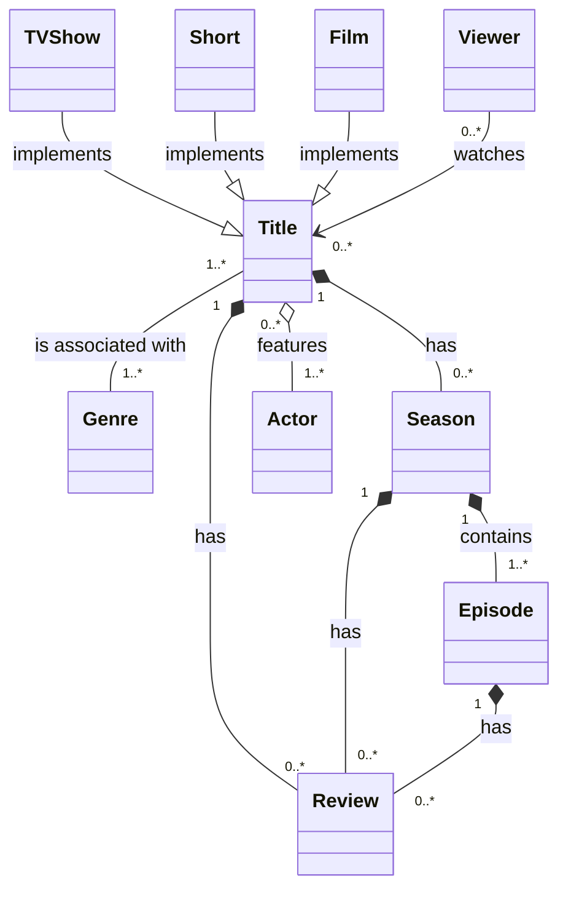
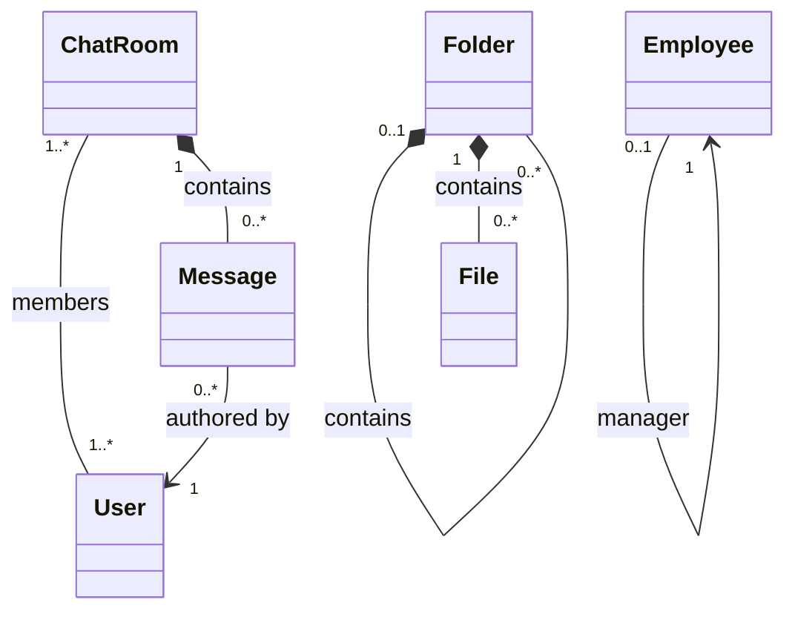
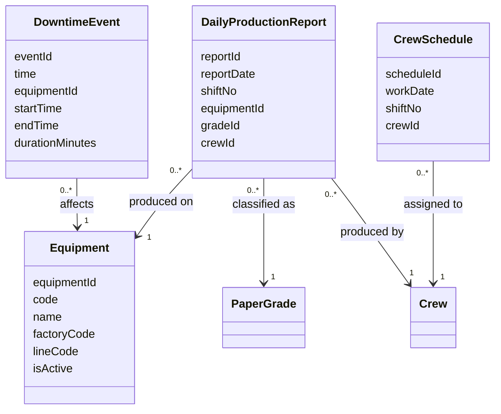

# Domain Entity Modeling & Relationship Descriptions

Design clear, expressive, and consistent domain models by evaluating whether relationships are necessary, choosing the right relationship types, defining directional references and ownership, weighing In-line data vs. References, specifying multiplicity/cardinality, writing descriptive relationship labels, and rendering clean UML / Mermaid class diagrams.

## When to Use

- Designing entity layouts, UML class diagrams, or domain models from scratch
- Evaluating the long-term performance costs of adding relationships (e.g., avoiding bloated graphs or cascading bottlenecks)
- Deciding between storing related data **In-line** vs. via **References** (balancing network calls vs. payload size and database joins)
- Deciding whether entities should be linked via Association, Aggregation, Composition, Inheritance, Reference, Self-Reference, or Many-to-Many relationships
- Defining multiplicity and cardinality (e.g., `"1"`, `"0..*"`, `"1..*"`) between domain entities
- Adding directional references (`-->` vs `--`) and descriptive relationship labels (avoiding overusing "has")
- Refactoring domain schemas to clarify entity ownership, cascading deletion behavior, inheritance hierarchies (`--|>`, `implements`, `extends`), or hierarchical ownership (`*--` like folders and chat rooms)
- Translating domain relationships into Mermaid `classDiagram` syntax with full annotations

## Steps

### 1. Identify Core Domain Entities, Abstractions, and Necessity

- **Singular Naming:** List distinct concepts in the domain using **singular names** (e.g., `Title`, `Season`, `Episode`, `User`, `Message`) to mirror code class names and avoid implying that an entity always exists in multiples.
- **Abstract Parent Entities:** Look for shared concepts that can be represented by an abstract parent entity (e.g., `Title` representing video content types like `TVShow`, `Film`, and `Short`).
- **Evaluate Relationship Necessity:** Before linking entities, ask: *Do we need a relationship at all?* Avoid needlessly connecting everything into a massive web. Reference relationships should be purposeful, fundamental to the application's primary goal (e.g., user follow networks on Instagram), and not accidental or premature, as complex interconnected graphs can cause severe performance degradation at scale.

### 2. Choose Between In-line Data vs. References

When a relationship is necessary, decide how related data is retrieved and stored:
- **In-line Data:** Storing a duplicate copy or nested details inside the resource (e.g., embedding an administrator object directly in `ChatRoom`).
  - *Pros:* Requires fewer API network calls to retrieve data.
  - *Cons:* Increases payload size, creates redundant data, and introduces heavy database join overhead.
- **References / Pointers:** Storing only a pointer or foreign key ID (e.g., `adminUserId`).
  - *Pros:* Keeps payloads lean and efficient.
  - *Cons:* Requires a secondary lookup call if the related resource's details are needed.
- **Rule of Thumb:** Optimize for the common case without compromising advanced needs. Consider resource size, frequency of access, and growth patterns.

### 3. Evaluate Ownership, Lifecycle Coupling, and Directionality

For every pair of interacting entities, evaluate:
- **Directionality & Reference:** Does one entity hold a reference to the other unilaterally (`-->`), or do they reference each other mutually (`--`)?
- **Specialization ("is-a"):** Is one entity a specific subtype or variant of a broader, abstract entity?
- **Ownership & Hierarchies:** Does one entity act as a parent or container that owns the relationship? Hierarchical relationships (like folders containing files or `ChatRoom` owning `Message`) imply upward pointers, containment, inherited access, and cascading deletion behavior.
- **Lifecycle dependency:** If the parent entity is deleted, does the child entity still make sense and exist independently, or must it be deleted too?

### 4. Select the Relationship Type and Descriptive Label

Avoid relying solely on "has" for every relationship. Write descriptive labels from the parent's point of view, or bidirectional phrasing when appropriate.

#### Association (`--` or `-->`)
- **Definition:** A general relationship where at least one entity holds a reference to the other. Use `-->` for directional association and `--` for bidirectional association.
- **Reference / Foreign Key Relationship:** A unidirectional reference where a resource points to exactly one target (e.g., `Message` has an `author` field pointing to a `User`), forming a many-to-one relationship.
- **Many-to-Many Association:** Resources pointing to multiple instances of each other (e.g., `ChatRoom` pointing to multiple `User` members, and each `User` joining multiple chat rooms).
- **Self-Reference Relationship:** A resource pointing to another resource of the exact same type, common in tree hierarchies or directed graphs (e.g., an `Employee` pointing to another `Employee` as a `manager` or `assistant`).
- **Example & Labels:** `Title -- Genre: is associated with` (bidirectional); `Viewer --> Title: watches` (directional); `Message --> User: authored by` (many-to-one reference); `Employee --> Employee: reports to` (self-reference).

#### Aggregation (`o--`)
- **Definition:** A more direct container relationship with loose lifecycle coupling.
- **Ownership:** One entity acts as the parent/owner.
- **Lifecycle:** The child can exist independently if the parent is deleted.
- **Example & Label:** `Title o-- Actor: features`.

#### Composition / Hierarchy (`*--`)
- **Definition:** The tightest "part-of" relationship representing strict structural containment, cascading deletion, and inherited access (e.g., folders containing files, or `ChatRoom` containing `Message`, or `Season` containing `Episode`).
- **Ownership:** One entity strictly owns the relationship.
- **Lifecycle:** The child cannot exist meaningfully without the parent and must be deleted if the parent is deleted.
- **Example & Label:** `Season *-- Episode: contains` or `Title *-- Review: has`.

#### Inheritance / Generalization (`--|>`)
- **Definition:** An "is-a" subtype relationship where specialized child entities inherit traits from a broader abstract parent entity.
- **Description / Label:** Describe using terms like `implements` or `extends` to clarify the inheritance relationship for readers unfamiliar with diagram arrows.
- **Example & Label:** `TVShow --|> Title: implements`, `Film --|> Title: implements`.

### 5. Define Multiplicity and Cardinality

Specify how many instances of one entity relate to another by placing quoted cardinality values on either side of the relationship operator (e.g., `"1"`, `"0..*"`, `"1..*"`, `"0..1"`).

- **Multiplicity vs. Cardinality:** The pair of constraints on a relationship is its *multiplicity*; each individual side's constraint is that entity's *cardinality*.
- **Placement Rule (Opposite-Side Reading):** In Mermaid `classDiagram` syntax, each entity's cardinality is written on the **opposite side** of the relationship operator.
  - Syntax: `Title "1" *-- "0..*" Season: has`
  - Meaning: One `Title` has zero-to-many `Season`s (`0..*`), and each `Season` belongs to one `Title` (`1`).
  - **Reading Shortcut:** When reading left-to-right (`Title` to `Season`), mentally skip the first cardinality (`"1"`) and read the second (`"0..*"`): *"Title has 0 to many Seasons."*
- **Zero-Minimum vs. One-Minimum:** Use `"0..*"` when a parent can validly exist without any children yet (e.g., a newly announced `Title` with only a trailer and no `Season`s yet), and `"1..*"` when at least one child is required (e.g., a `Season` must contain at least one `Episode`). Use `"0..1"` for optional self-references (e.g., an employee without a manager or assistant).
- **Note on Generalization:** Inheritance relationships (`--|>`) represent type hierarchies rather than instance counts, so omit multiplicity quotes on generalization lines.

### 6. Document and Validate the Entity Layout in Mermaid

Present the resulting entity layout using Mermaid `classDiagram` syntax. Combine multiplicity quotes, relationship operators, and descriptive labels after a colon (`:`).

#### **Domain Model with Multiplicity, Inheritance, and Descriptive Labels:**

#### **API Resource References, Hierarchies, & Self-References:**

## Quick Reference Matrix

| Relationship | Mermaid Syntax | Owner Exists? | Child Survives Deletion? | Example with Multiplicity & Label |
| --- | --- | --- | --- | --- |
| **Association (Bidirectional)** | `--` | No | Yes | `Title "1..*" -- "1..*" Genre: is associated with` |
| **Association (Directional)** | `-->` | No | Yes | `Message "0..*" --> "1" User: authored by` |
| **Aggregation** | `o--` | Yes | Yes | `Title "0..*" o-- "1..*" Actor: features` |
| **Composition / Hierarchy** | `*--` | Yes | No | `Season "1" *-- "1..*" Episode: contains` |
| **Generalization** | `--|>` | N/A | N/A | `TVShow --|> Title: implements` |

## Gotchas

* **Evaluate relationship costs:** Do not connect every resource by default. Weigh performance degradation, payload bloat, and cascading update costs for high-traffic or massive graph relationships (like millions of followers).
* **Weigh In-line vs. Reference carefully:** In-lining reduces API round-trips but inflates payloads and join overhead; references keep payloads lean but require extra lookup queries.
* **Always use singular entity names:** Name entities `Title`, `Season`, `Episode`, `User`, `Message` rather than plurals. Pluralizing entity names misleads readers into assuming multiple instances always exist, whereas multiplicity handles counts accurately.
* **Avoid misreading opposite-side cardinality:** Remember that `A "1" *-- "0..*" B` means A relates to `0..*` instances of B (not 1). Skip the adjacent number when reading across a relationship.
* **Avoid overusing "has":** Be as descriptive as possible for relationship labels (e.g., `watches`, `features`, `contains`, `authored by`, `members`, `manager`, `is associated with`, `implements`).
* **Remove spaces from entity names in Mermaid `classDiagram`:** Class diagrams follow code identifier conventions and do not support spaces in entity names (e.g., write `TVShow` instead of `TV Show`).
* **Browser rendering quirk for multiplicity:** Safari on macOS has a known rendering bug where Mermaid multiplicity labels may not appear; test diagrams in Chromium-based browsers or Firefox when using `mermaid.live`.

## Repository Reference: MIZA DataHub

Use this as the concrete model when working in this repository. It is the
resolved version of the general guidance above.

### Locked rules

- Production day starts at `07:00` in `Asia/Ho_Chi_Minh`.
- `shift_no` is a value object, not an entity: `1` = `07:00-19:00`,
  `2` = `19:00-07:00` next day. There is no `ProductionShift` table.
- Crew rotation is company-wide. `CrewSchedule` is unique on
  `(work_date, shift_no)`.
- `Equipment` is a managed catalog. Its `factory_code` and `line_code` are
  value fields; there are no `Factory` or `Line` entities.
- `DailyProductionReport` is one machine for one production day and shift.
  Its unique key is `(report_date, shift_no, equipment_id)`.
- `DowntimeEvent` is independent. It references `Equipment` and is aggregated
  by equipment plus production day/shift; it has no `report_id`.
- Catalogs are referenced by ID and protected with `ON DELETE RESTRICT`.
  Historical facts must survive catalog retirement.

### Resolved domain model

### Relationship decisions

| Relationship | Decision | Multiplicity |
| --- | --- | --- |
| `DailyProductionReport` to `Equipment` | Keep as a reference; one machine per report | `"0..*" --> "1"` |
| `DailyProductionReport` to `PaperGrade` | Keep as a reference; grades are shared catalog data | `"0..*" --> "1"` |
| `DailyProductionReport` to `Crew` | Keep as a reference; crews are shared catalog data | `"0..*" --> "1"` |
| `CrewSchedule` to `Crew` | Keep as a reference; the schedule assigns one crew | `"0..*" --> "1"` |
| `DowntimeEvent` to `Equipment` | Keep as a reference; downtime is independent of reports | `"0..*" --> "1"` |
| `CrewSchedule` to `ProductionShift` | Remove; `shift_no` is a fixed value object | N/A |
| `Equipment` to `Line` / `Factory` | Do not create entities; keep `lineCode` / `factoryCode` fields | N/A |
| `DailyProductionReport` to `DowntimeEvent` | Do not add `report_id`; aggregate by equipment and time window | N/A |
| `DailyProductionReport` to OEE | Do not add a database relationship; use a read model keyed by day, shift, and equipment | N/A |
| `Equipment` to `Device` telemetry | Do not add a foreign key; map external telemetry by stable code or ID | N/A |

### In-line vs reference

- Reference IDs on facts: `equipmentId`, `gradeId`, `crewId`.
- In-line value objects: `shiftNo`, `factoryCode`, `lineCode`.
- Optional read models may inline names for the dashboard, but canonical
  resources return IDs and support expansion.
- Use immutable equipment IDs or stable codes in Influx tags. Do not join on
  mutable display names.
